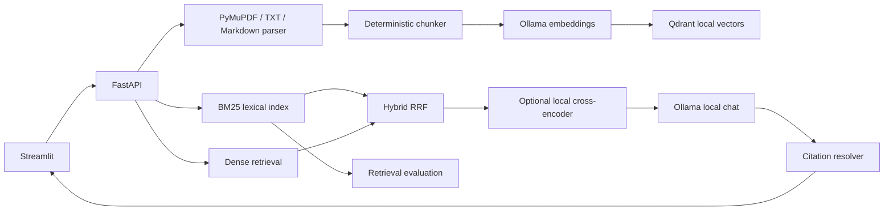

# Local RAG Research Assistant

A local-first research assistant for searching and asking questions about PDF, TXT, and Markdown documents. The project uses FastAPI for the API, Streamlit for the interface, Ollama for local embeddings and answer generation, and Qdrant for vector search.

It supports keyword search with BM25, dense retrieval, hybrid retrieval, and optional cross-encoder reranking. Answers can include citations linked to retrieved document excerpts. If retrieval finds no evidence, the system can abstain instead of generating an unsupported answer.

All model inference is handled by the configured Ollama service. The project does not use a cloud inference API or require an API key for model inference.

> The demo corpus contains self-authored examples for this project, not published scientific research. Do not cite it as published research.

## Features

- **Document management:** Upload and index documents with stable IDs, content hashes, page metadata, configurable chunk sizes and overlap, and duplicate detection.
- **Multiple retrieval strategies:** Compare BM25, dense retrieval with Ollama embeddings, hybrid Reciprocal Rank Fusion (RRF), and hybrid retrieval with an optional local cross-encoder.
- **Cited answers:** Generate answers with retrieved excerpts and deterministic citation resolution. The system can abstain when no supporting evidence is retrieved.
- **Evaluation:** Run retrieval-only benchmarks or enable local-model answer generation and check citation, evidence, and abstention behavior.
- **Web interface and API:** Use the Streamlit document library and chat interface, compare retrieval strategies, view results, and export evaluation data as JSON or CSV.
- **Local storage:** Store document metadata and vectors locally, with Qdrant as the vector index.
- **Optional tracing:** Run Arize Phoenix locally to inspect pipeline traces and stage timings.

## Architecture



## Quick start

### Requirements

- Python 3.10 or later (Python 3.12 recommended)
- [Ollama](https://ollama.com/download)
- Docker and Docker Compose for Qdrant
- Git, if you are cloning the project repository

Install Ollama using the official installer for your operating system. On Linux, follow the [Ollama Linux installation guide](https://github.com/ollama/ollama/blob/main/docs/linux.md). Start the Ollama service before running the application.

### 1. Download the models and start Qdrant

Pull the models used by the default configuration:

```bash
ollama pull qwen3.5:4b
ollama pull nomic-embed-text
ollama list
```

Start Qdrant:

```bash
docker compose up -d qdrant
```

### 2. Install the Python dependencies

Create and activate a virtual environment:

```bash
python3 -m venv .venv
source .venv/bin/activate
```

Install the project and development dependencies:

```bash
pip install -e '.[dev]'
```

Create your environment configuration:

```bash
cp .env.example .env
```

### 3. Start the API

Run the FastAPI application:

```bash
uvicorn rag_assistant.api.main:app --reload
```

### 4. Start the Streamlit interface

Open another terminal, activate the virtual environment, and run:

```bash
streamlit run app/streamlit_app.py
```

To load the demo documents, run:

```bash
python scripts/ingest_demo.py
```

### 5. Open the application

- Streamlit interface: `http://localhost:8501`
- FastAPI documentation: `http://localhost:8000/docs`
- Ollama readiness check: `http://localhost:8000/health/ollama`

You can also upload your own documents through the Document Library tab.

**Current limitation:** PDFs must contain extractable text. Scanned PDFs that require OCR are rejected because OCR is not implemented. The default upload size limit is 25 MB.

## Running with Docker Compose

The recommended setup runs Ollama natively and uses Docker for Qdrant and the application.

First, create `.env` and pull the required Ollama models on the host. Then run:

```bash
docker compose up --build -d
```

Compose configures `OLLAMA_BASE_URL` to use `host.docker.internal:11434` and includes a `host-gateway` mapping for Linux.

If the application container cannot reach Ollama because the service listens only on the loopback interface, configure Ollama to listen on an interface accessible to Docker. Restrict access with your host firewall.

Qdrant data and application metadata are stored in Docker volumes. Model weights are not included in the Docker image and must be downloaded separately.

Phoenix can be enabled with the optional observability profile described below.

## Models and local resource use

The default configuration uses:

- **Chat model:** `qwen3.5:4b`
- **Embedding model:** `nomic-embed-text`

Models are downloaded explicitly. Starting the application does not automatically pull model weights.

To try the larger chat model, update `.env`:

```env
OLLAMA_CHAT_MODEL=qwen3.5:9b
```

Then download it and restart the backend:

```bash
ollama pull qwen3.5:9b
```

The larger model requires more memory and disk space. Performance depends on the available hardware and model quantization. An internet connection is generally needed for the initial model downloads.

All inference requests are sent to the configured Ollama endpoint. The application does not fall back to an external model provider.

### Changing the embedding model

Changing the embedding model or vector dimensions requires a new Qdrant collection and reindexing all documents. Vectors with incompatible dimensions must not be stored in the same collection.

To switch collections:

1. Set `QDRANT_COLLECTION` to a new collection name in `.env`.
2. Restart the API.
3. Reindex each document using its Reindex action.

Dense retrieval uses Qdrant once the collection's vectors are ready. If Qdrant is unavailable, the application can fall back to persisted local vectors. Ollama is still required to generate embeddings for new queries.

### Optional cross-encoder reranking

Install the reranking dependencies:

```bash
pip install -e '.[rerank]'
```

The first enabled run may download `cross-encoder/ms-marco-MiniLM-L-6-v2` from Hugging Face into the local model cache. This requires disk space and CPU or GPU resources.

Reranking is disabled by default.

### Optional Phoenix tracing

Phoenix can be used to inspect pipeline traces and stage timings.

For a host-based setup, install the optional dependencies:

```bash
pip install -e '.[observability]'
```

For Docker, set the following in `.env` before rebuilding:

```env
INSTALL_OBSERVABILITY=true
```

Start the observability profile:

```bash
docker compose --profile observability up --build -d
```

Then enable tracing in `.env`:

```env
PHOENIX_ENABLED=true
```

Restart the API to apply the changes.

The application records OpenTelemetry spans for embedding, retrieval, reranking, and generation. These include stage durations and configured model names, but not document contents or full questions.

If Phoenix is unavailable, the application continues running and the API logs the tracing initialization failure.

The tracing setup uses Phoenix's `phoenix.otel.register` integration and OpenTelemetry spans. See the [Phoenix tracing concepts](https://arize.com/docs/phoenix/tracing/concepts-tracing/how-does-tracing-work) and [custom spans setup](https://arize.com/docs/phoenix/tracing/how-to-tracing/setup-tracing/custom-spans).

## API endpoints

The main endpoints are:

| Method | Endpoint                           | Purpose                                            |
| ------ | ---------------------------------- | -------------------------------------------------- |
| GET    | `/health`                          | Check application health                           |
| GET    | `/health/ollama`                   | Check Ollama readiness                             |
| POST   | `/documents/upload`                | Upload documents using the `files` multipart field |
| GET    | `/documents`                       | List indexed documents                             |
| POST   | `/documents/{document_id}/reindex` | Reindex a document                                 |
| DELETE | `/documents/{document_id}`         | Delete a document                                  |
| POST   | `/query`                           | Run a retrieval or question-answering query        |
| POST   | `/eval/run`                        | Run an evaluation                                  |
| GET    | `/eval/results`                    | Retrieve evaluation results                        |

The `/query` endpoint accepts a `question`, a retrieval `strategy`, `top_k`, and an optional `rerank` setting. Supported strategies are `bm25`, `dense`, `hybrid`, and `hybrid_rerank`.

### Behavior when Ollama is unavailable

The application can start in a degraded mode without Ollama.

In this mode, BM25 search and retrieval-only evaluation remain available. Document ingestion, dense retrieval, and answer generation require Ollama. The application does not switch to a cloud model when the local service is unavailable.

## Evaluation

The project includes a small evaluation dataset and a runner for comparing retrieval strategies.

The file `evals/golden_dataset.jsonl` contains version 1 of the dataset, with 32 example questions, including questions that should not be answerable from the available documents. The source corpus is synthetic and self-authored.

### Run BM25 evaluation

BM25 evaluation can run without Ollama:

```bash
python scripts/prepare_demo_eval.py
python -m rag_assistant.evaluation.runner
```

### Evaluate dense, hybrid, and reranked retrieval

Start Ollama with the configured embedding model, then prepare the indexed demo corpus using:

```bash
python scripts/ingest_demo.py
```

Start the API first, as required by the ingestion script. Run the evaluation runner afterward. Methods that cannot run because their required services or models are unavailable are marked as skipped.

### Evaluate answer generation

To include answer generation and citation/evidence checks for hybrid retrieval, run:

```bash
python -m rag_assistant.evaluation.runner --generation
```

The report records the model used, individual question outputs, failures, and measured generation latency. Token counts are not available through the current Ollama wrapper.

The generation checks cover citation behavior, expected evidence, and abstention. They are rule-based checks, not an LLM-based assessment of answer faithfulness.

### Evaluation outputs

The runner writes:

- `reports/latest.json`
- `reports/latest.csv`
- `reports/latest.png`

The PNG chart is generated with Matplotlib when native rendering is available. If plotting is skipped or fails, the runner writes an SVG chart instead.

The report includes four retrieval-method rows. Methods that cannot run because their local embedding or reranking requirements are unavailable are marked as skipped.

### Metrics

The evaluation uses binary relevance judgments at cutoff \(k\).

- **Recall@k:** The number of relevant retrieved items in the first \(k\) results divided by the total number of judged relevant items. Unanswerable questions have no relevant set and currently receive 0 in the aggregate.
- **MRR@k:** The reciprocal rank of the first relevant result within the first \(k\) results, or 0 if no relevant result is found.
- **nDCG@k:** Discounted cumulative gain divided by ideal discounted cumulative gain. Relevant results receive a gain of 1, irrelevant results receive 0, and the rank discount is `1/log2(rank+1)`.

The current judgments use stable document IDs. Every chunk belonging to a relevant document is treated as relevant, so these metrics measure relevance at the document level rather than the passage level.

For passage-level evaluation, add manually verified `relevant_chunk_ids` for a fixed corpus and chunking configuration.

### Current evaluation status

The evaluation runner supports BM25, dense, hybrid, and reranked retrieval, but benchmark results have not yet been measured and reported. Run the evaluation against a fixed corpus and review the results before drawing conclusions about which strategy performs best.

## Privacy, safety, and limitations

Documents and prompts are sent to the configured Ollama service for local inference. Embeddings and vectors are stored in Qdrant and local files. Protect the host machine, Docker volumes, and backups, especially when working with sensitive documents.

Avoid logging sensitive document text.

Citations are resolved against retrieved chunks, but a citation does not guarantee that every sentence in an answer is supported. Review the cited excerpts when accuracy matters.

Other current limitations:

- **Chunking:** Chunk size is estimated using word counts rather than a model tokenizer.
- **OCR:** Scanned PDFs requiring OCR are not supported.
- **Authentication:** Authentication is not implemented.
- **Multi-user access:** User isolation is not implemented.
- **Streaming:** Streaming answer generation is not implemented.
- **Evaluation:** The project does not yet provide a calibrated answer-faithfulness evaluation.
- **Reindexing:** Documents must be reindexed when the embedding configuration changes.

## Development and tests

Install the development dependencies:

```bash
pip install -e '.[dev]'
```

Run the test suite:

```bash
pytest
```

The core tests use mocks and do not require Ollama, Qdrant, model weights, Docker, or network access. Optional integration tests should be run separately after the required local services have been started.
